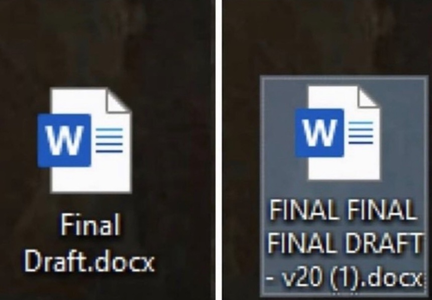

# dotfiles-final-final-v2

Pure nix version of [my dotfiles](https://github.com/Cbeck527/dotfiles) because
I am trying to be good at computers.

## Docs

- [Debian bootstrap](etc/doc/debian-bootstrap.md)
- Coder workspaces: `just coder-bootstrap` installs Lix and clones this repo to
  `~/.config/nix-config` (needs `just`, `git`, and `curl` on the image first).

## Layout

Each host file under `hosts/` imports everything it uses explicitly, so it can be
read on its own:

- `hosts/darwin/<host>`, `hosts/nixos/<host>`, `hosts/linux/coder`: one file per
  host. Each one picks its system modules and Home Manager layers and adds its own
  settings.
- `modules/darwin/`, `modules/nixos/`: system modules (defaults, the user
  account, Homebrew, services).
- `modules/home/`: Home Manager layers. `base` goes on every host, `darwin` on the
  Macs, and `dev` on machines I write code on.
- `modules/shared/`: options and Nix settings used by every platform.
- `packages/`: Home Manager program modules (fish, git, tmux, ...) and custom
  package derivations (`tea`, `datadog-pup`).

See [AGENTS.md](AGENTS.md) for the details.
